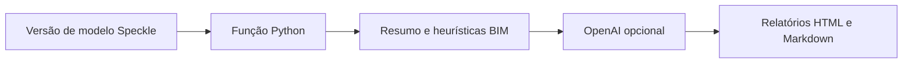

 |  | 

# Oráculo X-37 — Auditoria BIM via Speckle Automate

## Visão geral

O código é uma função Python para Speckle Automate que recebe um objeto/versão Speckle, percorre objetos BIM e calcula resumos e algumas métricas heurísticas, com possibilidade de enviar o prompt e o resumo à API OpenAI (modelo gpt-4o-mini). A saída inclui relatórios HTML e Markdown armazenados pelo contexto Speckle. A implementação observável é mais restrita que as alegações de IA preditiva, soberania/offline e auditoria completa do README.

## Objetivo e valor

**Problema/escopo:** Função Python para analisar objetos BIM recebidos via Speckle Automate, calcular verificações heurísticas e gerar relatórios HTML/Markdown com apoio opcional da API OpenAI.

**Valor verificável hoje:** o repositório torna explícitos seus artefatos, interfaces e limitações para que mantenedores e contribuidores possam avaliar o que existe sem confundir demonstração, proposta e produção.

## Arquitetura e tecnologias

Parcialmente documentada e não suficiente para sustentar as descrições de arquitetura robusta/modular: uma função Speckle Automate em main.py usa flatten.py para percorrer elementos BIM, monta métricas/resumo por regras, tenta chamada à API OpenAI e grava relatórios HTML/Markdown via AutomationContext. O diagrama Mermaid descreve aproximadamente esse fluxo. Não há evidência de serviço web/API standalone. Algumas métricas e valores de fallback são constantes, não resultados de atribuição XAI demonstrados.

- Python (metadado GitHub; pyproject exige Python >=3.11; Dockerfile usa python:3.11-slim)
- Dependências: specklepy >=3.2.4, speckle-automate >=0.1.0, openai >=2.31.0 e pydantic >=2.13.0
- Desenvolvimento: pytest, Ruff e mypy declarados como extras dev; existe Dockerfile e workflow GitHub Actions para gerar schema e publicar função Speckle Automate

## Início rápido

Os comandos abaixo refletem instruções, manifestos ou pontos de entrada presentes no repositório. Dependências externas, segredos e serviços estão indicados quando aplicável; a presença de um comando não equivale a uma execução validada.

1. git clone https://github.com/felipetjmg1-bit/ORACULOX37-V-3.6.9.git && cd ORACULOX37-V-3.6.9
2. pip install -e .; o manifesto exige Python >=3.11. A etapa do README para definir OPENAI_API_KEY não corresponde ao formato de entrada usado no código, que declara openai_api_key em FunctionInputs.
3. Workflow público instala pip install .[dev], executa python main.py generate_schema ${HOME}/functionSchema.json e configura a publicação para executar python -u main.py run. Esse último comando é usado como comando da função no fluxo Speckle Automate; não está demonstrado como aplicativo standalone.
4. Há tests/test_function.py, mas o workflow visível não executa testes. Nenhum comando de teste é apresentado como validado por execução na revisão estática do repositório.

## Exemplo de uso

Exemplo possível conforme interfaces do repositório: configurar no Speckle Automate os FunctionInputs openai_api_key e analysis_prompt, usando o formato ilustrado em example.function_inputs.json, e deixar o runner do Speckle invocar python -u main.py run. O ponto de integração Python declarado é execute_automate_function(automate_function, FunctionInputs); README não fornece contexto Speckle inicializado nem exemplo local autossuficiente.

## Estado e limitações

**Maturidade indicada:** Experimental.

- A implementação tenta enviar o prompt e o resumo dos dados à OpenAI quando há chave utilizável; portanto, o fluxo não é exclusivamente offline. Evitar afirmar residência nacional, soberania de dados, criptografia ou operação offline sem evidência adicional.
- O código usa valores fixos ou de fallback para várias métricas (incluindo métricas exibidas como integridade hierárquica e IDs únicos); quando não há objetos, substitui o resultado por contagens exemplificativas e total 150. O texto de fallback afirma alta coesão/conformidade mesmo sem análise concluída. Tratar os relatórios como potencialmente sintéticos, não como medições validadas.
- O README menciona API OpenAI; o manifesto e código confirmam dependência OpenAI, mas nenhum teste de integração ou execução foi realizado na revisão estática do repositório. Não afirmar que instalação, execução, testes ou publicação passaram.

## Contribuição

Leia [CONTRIBUTING.md](CONTRIBUTING.md) antes de abrir uma issue ou pull request. Para reportes de segurança, siga a orientação específica do repositório, se houver.

## Licença

Este repositório está licenciado sob **Apache-2.0**; consulte [LICENSE](LICENSE).

## Patrocínio e apoio

O desenvolvimento aberto exige tempo para manutenção, documentação, testes, revisão de contribuições e resposta a issues. Se este projeto for útil, considere apoiar a continuidade pelo [GitHub Sponsors](https://github.com/sponsors/felipetjmg1-bit). O apoio não representa promessa de funcionalidades, prazo de entrega ou suporte comercial.

