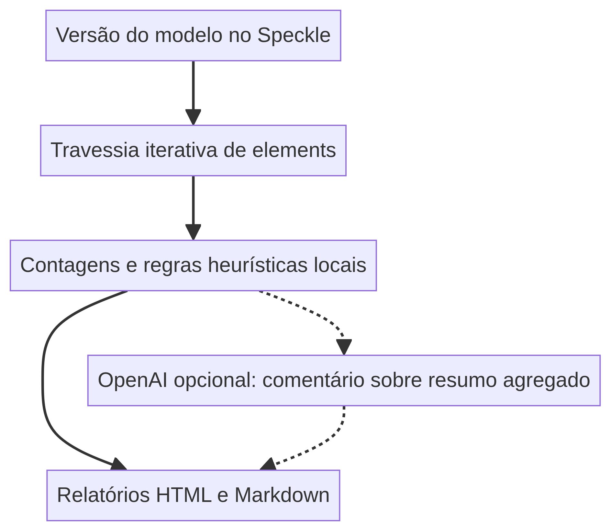

# Oráculo X-37 — verificações exploratórias de BIM no Speckle


[](LICENSE)
[](https://www.python.org/)

**Oráculo X-37** é uma função Python para Speckle Automate. Ela percorre a árvore de objetos recebida e produz contagens e verificações heurísticas simples, com relatórios HTML e Markdown. Um comentário textual opcional pode ser solicitado à API da OpenAI.

> **Maturidade e uso pretendido:** este repositório reflete a fase de experimentação e estudo prático do autor com ferramentas modernas. É um protótipo de nível inicial a intermediário em Python e Speckle Automate, com uso opcional da API da OpenAI. FastAPI, MCP e Gradio são temas explorados em outros experimentos do autor, não integrações presentes neste repositório. Não há tecnologia proprietária disruptiva nem validação comercial consolidada. O projeto não é um modelo preditivo, não realiza cálculo estrutural, não certifica conformidade normativa e não deve fundamentar decisões de segurança ou engenharia sem validação independente.

## O que a implementação faz hoje

- Percorre objetos acessíveis pela propriedade `elements` ou `@elements`, incluindo o objeto raiz, com proteção contra ciclos.
- Conta objetos por `speckle_type`.
- Aplica uma heurística baseada nos termos `structure`, `beam`, `column` e `wall` para identificar tipos potencialmente estruturais.
- Conta objetos sem `id`, ocorrências excedentes de IDs repetidos e objetos identificados pela heurística sem a propriedade `material` preenchida.
- Armazena relatórios HTML e Markdown no resultado da execução Speckle Automate.
- Se uma chave for configurada, pode enviar à OpenAI o prompt informado e um resumo agregado por tipo. Objetos BIM brutos e IDs individuais não fazem parte desse resumo.

As verificações são contagens e regras de presença implementadas em `audit.py`; não são uma pontuação de risco, medição de qualidade, explicação de um modelo de machine learning nem prova de conformidade.

## Arquitetura



[Fonte editável do diagrama](assets/architecture_diagram.mmd).

- `main.py`: integração com Speckle Automate, geração de relatórios e comentário externo opcional.
- `flatten.py`: travessia iterativa da árvore `elements`, com proteção contra ciclos.
- `audit.py`: regras locais e formatação do resumo agregado.
- `tests/`: testes unitários sem conexão com Speckle ou OpenAI.

## Limitações importantes

- A identificação de objetos estruturais depende apenas de correspondência de palavras no nome do tipo; ela pode classificar itens incorretamente ou deixar tipos de fora.
- A propriedade de material examinada é `material`; o código não interpreta toda a variedade de propriedades, classificações ou vínculos possíveis em modelos BIM.
- O código não verifica geometria, cálculos, hierarquia espacial, normas, segurança, validade de projeto, causalidade ou risco estrutural.
- IDs são comparados como texto exatamente como recebidos. O relatório mostra contagens, mas não inclui os valores de IDs.
- O comentário da OpenAI é texto gerado externamente e não é uma validação independente. Falhas nesse serviço não impedem a geração local do relatório.
- O repositório não demonstra integração com DREX, infraestrutura nacional, criptografia específica, certificação de segurança, operação exclusivamente offline ou explicabilidade nativa de um modelo de IA.

## Privacidade e segredos

Sem `openaiApiKey`, a função não tenta chamar a OpenAI. Quando a chave é fornecida, somente o prompt configurado e o resumo agregado por tipo são enviados para o serviço externo; não são enviados objetos BIM individuais nem seus IDs por esse caminho. Avalie, ainda assim, se os nomes de tipos e o prompt podem conter informações confidenciais. Use os campos protegidos de entrada do Speckle Automate para segredos. Não faça commit de chaves ou tokens em arquivos JSON, `.env` ou logs.

## Instalação e validação local

Requisitos: Python 3.11 ou superior.

```bash
git clone https://github.com/felipetjmg1-bit/ORACULOX37-V-3.6.9.git
cd ORACULOX37-V-3.6.9
python -m venv .venv
source .venv/bin/activate  # Windows: .venv\Scripts\activate
python -m pip install --upgrade pip
python -m pip install -e ".[dev]"
python -m pytest
ruff check .
```

Os testes unitários usam objetos fictícios pequenos e não acessam modelos de clientes, o Speckle hospedado nem a OpenAI. Passar nesses testes não constitui validação de desempenho em modelos BIM reais.

## Execução no Speckle Automate

O workflow de publicação gera o schema com:

```bash
python main.py generate_schema functionSchema.json
```

O runner do Speckle executa a função com:

```bash
python -u main.py run
```

No formulário do Speckle, os campos são publicados como `analysisPrompt` e `openaiApiKey`. A chave é opcional; quando ausente, os relatórios contêm somente os resultados locais. O arquivo `example.function_inputs.json` é ilustrativo e seus valores de placeholder não são credenciais utilizáveis.

A execução é marcada como falha quando não recebe uma versão de modelo, não consegue percorrer objetos ou não consegue gravar/armazenar os relatórios. A falha da chamada opcional à OpenAI é indicada no relatório; nesse caso, as contagens locais continuam disponíveis.

## Desenvolvimento

```bash
python -m pytest
ruff check .
```

Pull requests devem descrever mudanças, verificações executadas e limitações remanescentes. Consulte [CONTRIBUTING.md](CONTRIBUTING.md) e [SECURITY.md](SECURITY.md).

## Licença e contato

Este projeto está sob a licença [Apache-2.0](LICENSE). O código e a documentação descrevem o estado observável do protótipo; não representam certificação, promessa de desempenho, prazo de entrega ou garantia de adequação a uma finalidade específica.
